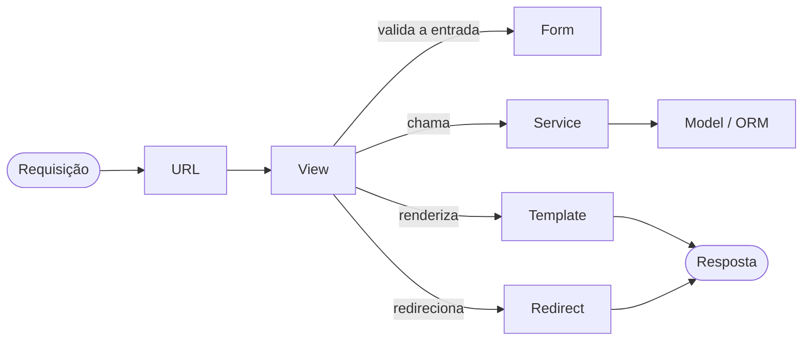

# Arquitetura

O ReMed é uma plataforma web de doação e redistribuição de medicamentos não vencidos. O projeto segue MVT, com as regras de negócio concentradas na camada de service. O motivo dessa decisão está na [ADR 0001](adr/0001-django-mvt-com-camada-de-service.md).

Este documento descreve **como o código é organizado**. O que construir está no PRD (`docs/prd/`) e nas specs (`docs/specs/`); o porquê das escolhas está nas ADRs (`docs/adr/`). Quando houver conflito entre este documento e uma ADR `aceita`, a ADR prevalece e este documento deve ser corrigido.

## Stack

| Item | Decisão | Origem |
| --- | --- | --- |
| Linguagem | Python 3.14 | Decisão do projeto |
| Framework | Django, padrão MVT | [ADR 0001](adr/0001-django-mvt-com-camada-de-service.md) |
| Banco de dados | PostgreSQL | [ADR 0002](adr/0002-postgresql-como-banco-de-dados.md) |
| Dependências | `pip` com ambiente virtual `.venv` e `requirements.txt` (versões fixadas) | Decisão do projeto; ADR a registrar |
| Front-end | Templates do Django, renderização no servidor | ADR 0001 |
| CSS | Bootstrap, hospedado no próprio projeto (sem CDN) | Decisão do projeto; ADR a registrar |
| JavaScript | JavaScript simples, sem framework de front-end | Decisão do projeto; ADR a registrar |

Itens ainda sem decisão (ferramenta de testes, formatador e linter, hospedagem) estão em [Decisões pendentes](#decisões-pendentes). Não adote nenhum deles sem registrar a decisão.

## Fluxo de uma requisição



## Responsabilidade de cada camada

| Camada | Faz | Não faz |
| --- | --- | --- |
| View | Lê a entrada, chama form e service, converte exceções de domínio em resposta HTTP, renderiza ou redireciona | Regra de negócio, acesso ao ORM |
| Form | Valida o formato da entrada e renderiza os campos | Regra que depende de outras entidades ou do estado do sistema, gravação |
| Service | Regra de negócio, consultas ao ORM, transações, verificação de permissão sobre objetos, histórico | Receber `request`, devolver `HttpResponse` |
| Model | Campos, relacionamentos, constraints e metadados | Regra de negócio |
| Template | Apresentação | Lógica de negócio, consultas, decisões de permissão |

## Estrutura do projeto

```
<raiz>/
├── config/                 # settings, urls e wsgi/asgi do projeto
├── <app>/                  # um app por contexto do domínio
│   ├── models/
│   ├── forms/
│   ├── services/
│   ├── views/
│   ├── exceptions.py
│   ├── urls.py
│   └── tests/
├── templates/
├── static/
├── .agents/
│   └── skills/             # skills usadas pelos agentes de IA
├── .venv/                  # ambiente virtual (fora do Git)
├── docs/
│   ├── prd/
│   ├── specs/
│   ├── adr/
│   ├── arquitetura.md
│   └── state.md
├── .gitignore
├── manage.py
└── requirements.txt
```

### Apps (proposta, a confirmar)

Os apps seguem os contextos do domínio. A divisão abaixo é uma **proposta** e só vale depois que o usuário a confirmar; não crie app novo sem justificar aqui.

| App | Contexto |
| --- | --- |
| `contas` | Cadastro, autenticação, perfis e permissões |
| `medicamentos` | Doações e informações dos medicamentos |
| `solicitacoes` | Solicitações de medicamentos |
| `correspondencias` | Correspondência entre doação e solicitação, agendamento e entrega |
| `pontos_coleta` | Pontos de coleta e sua aprovação |

## Views (`<app>/views/`)

- Toda view é uma classe que herda diretamente de `django.views.View`.
- Implemente apenas os métodos HTTP necessários (`get`, `post`).
- Mixins de controle de acesso, como `LoginRequiredMixin`, são permitidos.
- Não use views baseadas em função nem generic views (`ListView`, `CreateView` etc.).
- A view só recebe a requisição, chama o service e retorna a resposta (template ou redirect).
- A view não contém regra de negócio nem acessa o ORM diretamente. Por isso, não usa `get_object_or_404`.
- Alterações de dados só por POST, com ``, seguidas de redirect (POST/Redirect/GET).
- Cada view declara os perfis que podem acessá-la. O service reconfere o direito sobre o objeto.
- `login()` e `logout()` são chamados na view, pois alteram a sessão HTTP e precisam de `request`.

## Forms (`<app>/forms/`)

- Validam o formato da entrada (por exemplo, CPF, CNPJ, CEP, tamanho e tipo de arquivo) e renderizam os campos.
- Declaram `fields` explicitamente. Nunca usam `__all__` nem expõem campos controlados pelo sistema, como `status` e `perfil`.
- A gravação é feita pelo service, sem `form.save()`.
- As mensagens de validação seguem o texto definido no catálogo de requisitos.

## Services (`<app>/services/`)

- Toda regra de negócio fica aqui, incluindo validações de negócio e consultas ao ORM.
- Services não recebem `request` nem retornam `HttpResponse`.
- Falhas são comunicadas por exceções de domínio (`<app>/exceptions.py`), que a view converte em respostas HTTP.
- A permissão sobre o objeto é verificada no service, filtrando pelo dono na própria consulta. Objeto de outra pessoa é tratado como "não encontrado".
- Operações que dependem umas das outras (reserva, agendamento e entrega) são transacionais e impedem reserva dupla. O mecanismo exato é decisão pendente (veja abaixo).
- Rotinas automáticas (validade diária, expirações, lembretes) também são services, chamados por comandos de gerenciamento.
- Notificações e chamadas a serviços externos ficam em services dedicados. A falha deles não pode impedir o fluxo principal.

## Models (`<app>/models/`)

- Definem campos, relacionamentos e metadados, sem regra de negócio.
- Garantem integridade no banco com constraints (unicidade de CPF, CNPJ e e-mail, quantidade não negativa) e índices nos campos de busca.
- Status são enumerações (`TextChoices`) com os valores do catálogo de requisitos.
- Registros que o documento manda preservar (doações, solicitações, pontos de coleta, entregas) não são excluídos: muda-se o status, e `on_delete` usa `PROTECT` onde a cascata apagaria histórico.
- Datas e horas usam fuso (`USE_TZ = True`).

## Templates

- Cuidam apenas da apresentação, sem lógica de negócio.
- Mantêm o autoescape ligado e não usam `safe` em conteúdo de usuário.
- Não exibem dados que o perfil não pode ver (por exemplo, contato ou endereço do doador na busca).
- Aparência e acessibilidade seguem a skill de UI/UX e os requisitos de acessibilidade do PRD.

### Bootstrap e estilos

- O projeto usa **Bootstrap** como base de CSS. Fixe a versão na ADR correspondente.
- Os arquivos do Bootstrap ficam em `static/`, servidos pelo próprio projeto. Não carregue por CDN, para reduzir requisições externas e consumo de dados.
- A identidade visual do ReMed é aplicada por um único arquivo de estilos próprio (`static/css/remed.css`, nome a confirmar), que sobrescreve as variáveis do Bootstrap e define os design tokens. Não espalhe cores, tamanhos ou espaçamentos fora desse arquivo.
- Prefira os componentes do Bootstrap (formulários, alertas, abas, cartões, etiquetas) a criar componentes novos. Personalize pelos tokens, não por estilos soltos nos templates.
- O Bootstrap não garante acessibilidade por si só: confira contraste, foco visível e rótulos.
- Use o JavaScript do Bootstrap só quando um componente exigir (por exemplo, abas ou menu recolhível), carregando apenas o necessário. Não adicione jQuery nem framework de front-end.
- Não adicione outra biblioteca de CSS ou de ícones sem ADR `aceita`.

## Admin

- O Admin não deve ignorar as regras dos services: suas ações chamam os services, e a escrita fica bloqueada nos models cujas regras dependem deles.

## Dependências

- O projeto usa `pip` com um ambiente virtual em `.venv/`. O diretório `.venv/` não vai para o Git (confirme que está no `.gitignore`).
- As dependências ficam em `requirements.txt`, com **versões fixadas**. Confirme que cada pacote suporta o Python 3.14 antes de fixar a versão.
- Adicione uma dependência só quando for necessária, conferindo nome, origem e manutenção do pacote, e registre-a no `requirements.txt`.
- Procure vulnerabilidades conhecidas nas dependências (por exemplo, com `pip-audit`).
- Trocar de gerenciador (Poetry, uv etc.) exige ADR.

## Configuração e segredos

- Segredos e parâmetros por ambiente vêm de variáveis de ambiente. O repositório mantém um `.env.example` sem valores reais.
- Valores de regra que o documento deixa "sugeridos" ou pendentes (prazos, limites) ficam em configuração nomeada, não espalhados no código.
- Antes de qualquer deploy, rode `python manage.py check --deploy`.

## Exemplos

Leitura:

```python
class DoacaoListView(View):
    def get(self, request):
        doacoes = DoacaoService.listar_disponiveis(request.GET)
        return render(request, "medicamentos/lista.html", {"doacoes": doacoes})
```

Alteração, com a exceção de domínio convertida em resposta HTTP:

```python
class DoacaoCancelarView(LoginRequiredMixin, View):
    def post(self, request, doacao_id):
        try:
            DoacaoService.cancelar(doacao_id, request.user)
        except DoacaoNaoEncontrada as exc:
            raise Http404 from exc
        messages.success(request, "Doação cancelada.")
        return redirect("medicamentos:minhas_doacoes")
```

## Decisões pendentes

Cada item abaixo precisa de uma ADR `aceita` antes de ser implementado. Esta lista deve ser atualizada conforme as ADRs forem criadas.

Este documento não cita IDs de requisitos de propósito: os requisitos ainda estão sendo revisados. A ligação entre cada decisão e os requisitos fica nas ADRs e no PRD.

| Tema |
| --- |
| Adoção do Bootstrap e do JavaScript simples (registrar a decisão já tomada) |
| Adoção do `pip` com `requirements.txt` como gerenciador de dependências (registrar a decisão já tomada) |
| API REST versus MVT puro |
| Modelo de usuário customizado |
| Hash de senha |
| Autenticação, sessão e bloqueio por tentativas, 2FA do Administrador |
| Reserva transacional e concorrência |
| Rotinas agendadas |
| Armazenamento de arquivos com criptografia |
| Geolocalização e cálculo de distância |
| Integração de IA para leitura da embalagem (modelo multimodal) |
| Notificações (e-mail e na plataforma) |
| Histórico e auditoria |
| Ferramentas de teste, formatação e lint |
| Hospedagem e implantação |
