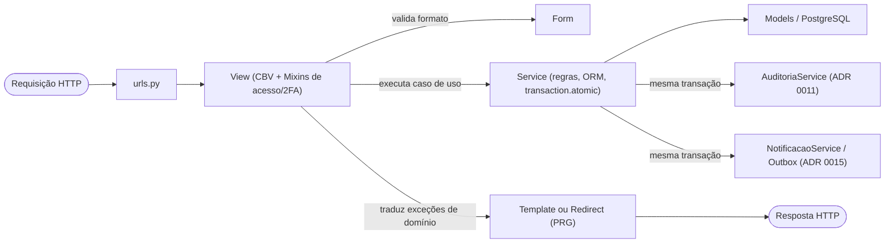

# Arquitetura — ReMed

Este documento descreve **como o ReMed é organizado e construído**, consolidando as **20 ADRs aceitas** ([0001](adr/0001-django-mvt-com-camada-de-service.md) a [0020](adr/0020-configuracao-variaveis-ambiente-python-dotenv.md)) em um mapa único de referência para o desenvolvimento e para as specs.

- **O quê e por quê:** [PRD](prd/01-remed.md) e [catálogo de requisitos](prd/02-catalogo-requisitos.md).
- **Por que cada escolha técnica foi tomada:** [índice de ADRs](adr/README.md).
- **Detalhamento por caso de uso:** `docs/specs/`.

> [!IMPORTANT]
> **Precedência das ADRs:** em caso de conflito entre este documento e qualquer ADR `aceita` em `docs/adr/`, **a ADR prevalece** e este documento deve ser corrigido.

---

## 1. Mapa consolidado da stack e das decisões (ADRs 0001 a 0020)

| Área | Decisão consolidada | ADR |
| --- | --- | --- |
| Framework e camadas | Django 6.1 no padrão **MVT com camada de service** e templates renderizados no servidor (sem API REST no MVP) | [ADR 0001](adr/0001-django-mvt-com-camada-de-service.md) |
| Banco de dados | **PostgreSQL** (`psycopg` 3), com constraints e transações ACID | [ADR 0002](adr/0002-postgresql-como-banco-de-dados.md) |
| Linguagem | **Python 3.14** em todos os ambientes | [ADR 0003](adr/0003-python-3-14.md) |
| Dependências | `pip` + `.venv` (fora do Git) + `requirements.txt` (produção) e `requirements-dev.txt` (desenvolvimento) com versões fixadas por `==`; pacotes só entram quando necessários | [ADR 0004](adr/0004-pip-venv-requirements-fixado.md), [ADR 0012](adr/0012-ferramentas-teste-formatacao-lint-e-seguranca.md) |
| CSS e interface | **Bootstrap** hospedado em `static/` (sem CDN) + arquivo próprio de design tokens (`static/css/remed.css`), seguindo WCAG 2.1 AA | [ADR 0005](adr/0005-bootstrap-hospedado-no-projeto.md) |
| JavaScript | **JavaScript simples** (sem framework de front-end, sem jQuery e sem htmx); validação real sempre no servidor | [ADR 0006](adr/0006-javascript-simples-sem-framework.md) |
| Usuário e LGPD | Modelo customizado (`AbstractBaseUser` + `PermissionsMixin`), `USERNAME_FIELD = "email"`, login por **e-mail ou CPF** (sem CNPJ), login bloqueado até confirmar e-mail, `inativo` reversível, CPF protegido no banco/disco (busca parcial), encerramento LGPD com `email`/`cpf` anuláveis + `UniqueConstraint` parcial + `CheckConstraint` (vedado a contas suspensas/bloqueadas) | [ADR 0007](adr/0007-modelo-de-usuario-customizado.md) |
| Hash de senha | **Argon2id** (`Argon2PasswordHasher`, padrões do Django 6.1.3 até benchmark na produção pós-RNF11; `argon2-cffi` entra no RF001) | [ADR 0008](adr/0008-hash-de-senha-argon2-ou-bcrypt.md) |
| Sessão, bloqueio e 2FA | Sessões no PostgreSQL (`backends.db`, 30 min de inatividade); tabela própria de acessos + bloqueio de 15 min configurável após 5 falhas em 15 min; **TOTP (RFC 6238)** via `pyotp` na camada de service com códigos de recuperação em hash, *step-up* 2FA no RF004 e reset por outro Admin (exige ≥ 2 Admins ativos) | [ADR 0009](adr/0009-sessao-bloqueio-tentativas-e-2fa-administrador.md) |
| Perfis e permissões | Perfis de cidadão no domínio (`Doador`, `Solicitante`, `Cuidador/Familiar`) + vínculo ativo de responsável por `PontoColeta`; **8 funções administrativas separadas** via `Group`/`Permission` (`gestao_usuarios`, `aprovacao_pontos_coleta`, `conferencia_doacoes`, `verificacao_receitas`, `moderacao_denuncias`, `metricas_e_parametros`, `gestao_administradores` e `auditoria`), com proibição técnica de acumular `gestao_usuarios` e `verificacao_receitas`; `is_superuser` restrito ao bootstrap por terminal | [ADR 0010](adr/0010-perfis-e-permissoes.md), [ADR 0011](adr/0011-historico-imutavel-e-auditoria.md) |
| Histórico e auditoria | Tabela própria `append-only` (`RegistroAuditoria`) + `AuditoriaService` explícito nas transações + trigger `BEFORE UPDATE OR DELETE` no PostgreSQL (também na tabela de acessos); sem PII bruto/receitas/segredos; consulta exclusiva à função `auditoria`; expurgo futuro LGPD apenas por role administrativa de banco | [ADR 0011](adr/0011-historico-imutavel-e-auditoria.md) |
| Qualidade, testes e CI | `python manage.py test` (PostgreSQL) + `coverage` (sem meta mínima) + `ruff` (`check` com regras `S` + `format`) + `pip-audit` + `requirements-dev.txt`; `djlint` fora do MVP; GitHub Actions no CI | [ADR 0012](adr/0012-ferramentas-teste-formatacao-lint-e-seguranca.md), [ADR 0019](adr/0019-hospedagem-implantacao-e-backup.md) |
| Reserva e concorrência | `transaction.atomic()` + `select_for_update()` padrão em ordem fixa (`Doacao -> Solicitacao -> Correspondencia -> Agendamento`) + `CheckConstraint` de quantidade + `UniqueConstraint` parcial (1 reserva ativa por doação; saldo volta a `"disponível"` após entrega parcial; expiração inicial de 48 h configurável) | [ADR 0013](adr/0013-reserva-transacional-e-concorrencia.md) |
| Rotinas agendadas | Base de rotinas no MVP via services idempotentes + comandos `manage.py` + `pg_try_advisory_lock` + tabela `ExecucaoRotina`; falha no RF012 gera alerta + até 3 tentativas a cada 15 min; parâmetros do RF012 em tabela editável e demais prazos em `settings` | [ADR 0014](adr/0014-rotinas-agendadas.md) |
| Notificações | Padrão *Transactional Outbox* no PostgreSQL (despacho a cada 1 min para todos os e-mails, até 3 novas tentativas) + SMTP nativo do Django + limite por usuário suprimindo só e-mails não críticos; preferências na v1.1 | [ADR 0015](adr/0015-notificacoes-email-e-plataforma.md) |
| Arquivos e antimalware | Object Storage S3-compatível privado com SSE (sem criptografia extra na aplicação); validação de tamanho (5 MB), extensão, *magic bytes* e `Pillow >= 12.0` (remoção EXIF/GPS); interface antimalware no MVP e `clamd` na implantação; nomes UUID e entrega por URL pré-assinada de 60 s via rota autenticada com auditoria | [ADR 0016](adr/0016-armazenamento-seguro-de-arquivos.md) |
| Geolocalização | PostgreSQL padrão (`latitude`/`longitude` aproximadas + *bounding box* + Haversine no servidor); geocodificação via BrasilAPI CEP v2 + fallback Nominatim (com cache persistente obrigatório e cumprimento da Nominatim Usage Policy); última localização da busca apenas na sessão | [ADR 0017](adr/0017-geolocalizacao-e-calculo-de-distancia.md) |
| Consulta de CEP | Proxy no servidor (`CepService`) com cache persistente no PostgreSQL (`CacheCep`) e rate limit por IP; BrasilAPI primário + ViaCEP fallback + `urllib.request` da biblioteca padrão; preenchimento manual se ambos falharem | [ADR 0018](adr/0018-consulta-de-cep.md) |
| Hospedagem e backup | Contêiner Docker (Python 3.14) + `gunicorn` + `whitenoise` em PaaS gerenciado + PostgreSQL gerenciado + S3 + CronJobs + SMTP sob domínio oficial; homologação acadêmica agora e produção somente pós-validação jurídica do RNF11 (com backup diário 30 dias, teste mensal de restauração e benchmark do Argon2id) | [ADR 0019](adr/0019-hospedagem-implantacao-e-backup.md) |
| Configuração e segredos | Variáveis de ambiente com `python-dotenv` (`load_dotenv(override=False)`), leitura explícita via `os.environ` e `.env.example` versionado sem segredos | [ADR 0020](adr/0020-configuracao-variaveis-ambiente-python-dotenv.md) |

*Decisões ainda sem ADR (reservadas para a v2.0):* API REST (RNF09) e provedor de IA multimodal para leitura da embalagem (RF009).

---

## 2. Arquitetura em camadas e fluxo da requisição

Toda requisição web segue o fluxo da [ADR 0001](adr/0001-django-mvt-com-camada-de-service.md):



| Camada | Faz | Não faz |
| --- | --- | --- |
| **View** | Lê `GET`/`POST`, declara mixins de autenticação, 2FA e perfil/função ([ADR 0010](adr/0010-perfis-e-permissoes.md)), valida formato com `Form`, chama `Service`, executa `login()`/`logout()` quando aplicável, traduz exceções de domínio em resposta HTTP (404, 403 ou mensagem de erro) e renderiza ou redireciona (POST/Redirect/GET) | Regra de negócio, consultas ao ORM (`Model.objects`, `get_object_or_404`) |
| **Form** | Valida formato e campos da entrada (dígitos de CPF/CNPJ, formato de CEP, limites de caracteres, extensão/tamanho inicial de arquivo) com `Meta.fields` explícito | Regra que depende do estado do banco ou de outras entidades, persistência direta |
| **Service** | Concentra regras de negócio, consultas ao ORM (`select_related`/`prefetch_related`), verificação de permissão por objeto, transações com `select_for_update()` ([ADR 0013](adr/0013-reserva-transacional-e-concorrencia.md)), chamadas a `AuditoriaService` ([ADR 0011](adr/0011-historico-imutavel-e-auditoria.md)) e `NotificacaoService` ([ADR 0015](adr/0015-notificacoes-email-e-plataforma.md)) | Receber `request`, `form` ou devolver `HttpResponse` |
| **Model** | Define campos, relacionamentos, `TextChoices`, índices e constraints (`UniqueConstraint`, `CheckConstraint`, `on_delete=PROTECT` em histórico) | Regra de negócio em `save()`, `signals` ou propriedades que consultam o banco |
| **Template** | Apresentação acessível (WCAG 2.1 AA), autoescape ativo, `` em todo POST, avisos obrigatórios (RNF13) | Lógica de negócio, consultas ao ORM, `|safe` em conteúdo de usuário, exibição de dados vedados ao perfil |

---

## 3. Estrutura do repositório e divisão de apps Django

### Estrutura de diretórios

O `manage.py` existente aponta para `core.settings`. Os apps Django ficam **na raiz do projeto**:

```text
ReMed/
├── core/                       # settings, urls raiz, wsgi/asgi
├── nucleo/                     # infraestrutura transversal (arquivos, CEP, geo, rotinas, mixins)
├── contas/                     # usuários, autenticação, 2FA, perfis e funções administrativas
├── auditoria/                  # histórico imutável append-only (ADR 0011)
├── notificacoes/               # notificações na plataforma e outbox de e-mail (ADR 0015)
├── pontos_coleta/              # cadastro, documentos e aprovação de pontos de coleta
├── medicamentos/               # doações, refrigerados, conferência, vencimento e busca
├── solicitacoes/               # solicitações e verificação isolada de receitas
├── correspondencias/           # correspondência, reserva, agendamento, mensagens e entrega
├── moderacao/                  # denúncias e relatórios de métricas (v1.1)
├── templates/
│   ├── base.html
│   ├── partials/               # fragmentos reutilizáveis (_mensagens.html etc.)
│   └── <app>/
├── static/
│   ├── vendor/bootstrap/       # Bootstrap hospedado localmente (ADR 0005)
│   ├── css/remed.css           # design tokens e identidade visual ReMed
│   └── js/                     # JavaScript simples (ADR 0006)
├── docs/
│   ├── prd/
│   ├── adr/
│   ├── specs/
│   └── arquitetura.md
├── .github/workflows/          # CI GitHub Actions (ADR 0019)
├── .env.example                # variáveis obrigatórias sem valores reais
├── Dockerfile                  # Python 3.14 + gunicorn + whitenoise (ADR 0019)
├── manage.py
├── pyproject.toml              # configuração do ruff e coverage (ADR 0012)
├── requirements.txt            # produção, versões fixadas por == (ADR 0004)
└── requirements-dev.txt        # desenvolvimento (-r requirements.txt, ADR 0012)
```

Estrutura interna padrão de cada app (`<app>/`): `models/` (ou `models.py`), `forms/` (ou `forms.py`), `services/` (ou `services.py`), `views/` (ou `views.py`), `management/commands/` (quando houver rotinas ou bootstrap), `exceptions.py`, `urls.py` e `tests/`.

### Divisão de apps Django (confirmada)

Nenhum app novo deve ser criado sem justificar e atualizar esta tabela.

| App | Requisitos cobertos | Fase | Por quê (fronteira de contexto) |
| --- | --- | --- | --- |
| **`nucleo`** | Base transversal: arquivos (RNF16, RS013, [ADR 0016](adr/0016-armazenamento-seguro-de-arquivos.md)), CEP e geolocalização (RNF12, RS010, [ADR 0017](adr/0017-geolocalizacao-e-calculo-de-distancia.md), [ADR 0018](adr/0018-consulta-de-cep.md)), controle de rotinas (`ExecucaoRotina`, lock PostgreSQL — RNF15, [ADR 0014](adr/0014-rotinas-agendadas.md)), exceções base, mixins de permissão/2FA e cadastros auxiliares | MVP | Agrupa infraestrutura técnica compartilhada por vários domínios (`ArquivoService`, `CepService`, `CacheCep`, `ExecucaoRotina`, mixins e tabelas auxiliares de forma farmacêutica / tipo de estabelecimento / tipo de documento) sem criar dependências circulares nem multiplicar apps minúsculos. |
| **`contas`** | **RF001, RF002, RF003** (v1.1), **RF004** (MVP ⬆), RS005, RS012, RS015 ([ADRs 0007–0010](adr/0007-modelo-de-usuario-customizado.md)) | MVP / v1.1 | Concentra identidade, `AUTH_USER_MODEL`, perfis de cidadão, endereço privado do usuário, aceite de termos, autenticação (e-mail/CPF), tabela `append-only` de acessos e bloqueio (15 min), 2FA TOTP (`pyotp`) com códigos de recuperação, 8 funções administrativas e encerramento LGPD. Precisa ser o primeiro app de domínio a migrar (`AUTH_USER_MODEL`). |
| **`auditoria`** | **RNF14**, RS013 (solução 5), RS015 (solução 3) ([ADR 0011](adr/0011-historico-imutavel-e-auditoria.md)) | MVP | Isola a tabela `append-only` `RegistroAuditoria` (com trigger `BEFORE UPDATE OR DELETE`), o `AuditoriaService` e a consulta somente leitura restrita à função `auditoria`, mantendo a trilha transversal desacoplada dos fluxos operacionais. |
| **`notificacoes`** | **RF017**, RNF15, RS014 ([ADR 0015](adr/0015-notificacoes-email-e-plataforma.md)) | MVP | Centraliza a lista de notificações na plataforma, o *Transactional Outbox* de e-mails (despacho a cada 1 min, até 3 retentativas, SMTP nativo), os templates seguros sem PII e o limite de envio por usuário. |
| **`pontos_coleta`** | **RF005, RF006, RF007** (todos MVP ⬆), RS011 | MVP ⬆ | Delimita o ciclo de vida das instituições parceiras (CNPJ, endereço público, horários, refrigeração), o vínculo ativo de responsáveis (`PontoColetaResponsavel`), o versionamento de licença/alvará (via `ArquivoService`) e a aprovação/suspensão (`aprovacao_pontos_coleta`). |
| **`medicamentos`** | **RF008, RF010, RF011, RF012, RF015** (MVP), **RF009** (v2.0), RS001, RS004, RS009, RS010 | MVP / v2.0 | Reúne todo o lado da **oferta**: cadastro da doação e foto da embalagem, conservação de refrigerados, conferência de validade (`conferencia_doacoes`), rotina diária de vencimento + parâmetros editáveis do RF012 (`metricas_e_parametros`) e busca pública/autenticada por proximidade. |
| **`solicitacoes`** | **RF013, RF014** (MVP), RS002, RS003, RS006 | MVP | Separa o lado da **demanda** e isola as **receitas médicas** (dado sensível de saúde — RNF10, RS002), facilitando o controle rigoroso pela função isolada `verificacao_receitas` (proibida de acumular com `gestao_usuarios` — ADR 0010) e o bloqueio de controle especial (RS003). |
| **`correspondencias`** | **RF016, RF018, RF019** (MVP ⬆), **RF020** (MVP), RNF06, RS007, RS008, RS014 ([ADR 0013](adr/0013-reserva-transacional-e-concorrencia.md)) | MVP | Agrupa o encontro entre oferta e demanda sob a mesma disciplina transacional (`select_for_update()` em ordem fixa): correspondência automática, reserva exclusiva, agendamento de retirada, mensagens internas de texto com bloqueio de contato/links e confirmação/recusa de entrega com código. |
| **`moderacao`** | **RF021, RF022** (v1.1), RS006, RS015 | v1.1 | Separa denúncias/moderação (`moderacao_denuncias`) e relatórios agregados/anônimos com exportação CSV/PDF (`metricas_e_parametros`), ambos da v1.1, consumindo dados dos apps do MVP sem acoplar os fluxos essenciais. |

---

## 3.1 Dependências previstas (Python, front-end e infraestrutura)

Conforme a [ADR 0004](adr/0004-pip-venv-requirements-fixado.md), **cada pacote Python só entra no `requirements.txt` ou `requirements-dev.txt` (com versão fixada por `==` e todas as dependências indiretas) quando a spec ou etapa que precisa dele for implementada**, sempre após validação no `.venv` com Python 3.14.

| Dependência | Categoria | Destino / local | Quando entra (spec ou etapa) | ADR de origem |
| --- | --- | --- | --- | --- |
| `Django` (`6.1.3`, + indiretas `asgiref`, `sqlparse`, `tzdata`) | Produção (Python) | `requirements.txt` *(já instalado)* | Base do projeto | [ADR 0001](adr/0001-django-mvt-com-camada-de-service.md), [ADR 0004](adr/0004-pip-venv-requirements-fixado.md) |
| `psycopg` / `psycopg-binary` (`3.3.9`) | Produção (Python) | `requirements.txt` *(já instalado)* | Base do projeto | [ADR 0002](adr/0002-postgresql-como-banco-de-dados.md), [ADR 0004](adr/0004-pip-venv-requirements-fixado.md) |
| `python-dotenv` (`1.2.4`) | Produção (Python) | `requirements.txt` *(já instalado)* | Base do projeto (`.env`) | [ADR 0020](adr/0020-configuracao-variaveis-ambiente-python-dotenv.md) |
| `argon2-cffi` (+ indiretas `argon2-cffi-bindings`, `cffi` etc.) | Produção (Python) | `requirements.txt` | Spec `01` — RF001 (Cadastro de Usuário) | [ADR 0008](adr/0008-hash-de-senha-argon2-ou-bcrypt.md), [ADR 0004](adr/0004-pip-venv-requirements-fixado.md) |
| `pyotp` + `segno` *(QR code SVG local, Python puro; validar `segno` no Python 3.14 na instalação)* | Produção (Python) | `requirements.txt` | Spec `02` — RF002 (Autenticação e 2FA do Administrador) | [ADR 0009](adr/0009-sessao-bloqueio-tentativas-e-2fa-administrador.md), [ADR 0004](adr/0004-pip-venv-requirements-fixado.md) |
| `Pillow` (`>= 12.0`, suporte oficial Python 3.14) | Produção (Python) | `requirements.txt` | Spec do RF006 (ou RF008 — primeira spec com upload de imagem) | [ADR 0016](adr/0016-armazenamento-seguro-de-arquivos.md), [ADR 0004](adr/0004-pip-venv-requirements-fixado.md) |
| `django-storages` + `boto3` | Produção (Python) | `requirements.txt` | Empacotamento / implantação (Etapa 9 — ativação do bucket S3; em dev/testes usa `FileSystemStorage` em `PRIVATE_STORAGE_ROOT`) | [ADR 0016](adr/0016-armazenamento-seguro-de-arquivos.md), [ADR 0004](adr/0004-pip-venv-requirements-fixado.md) |
| `clamd` | Produção (Python) | `requirements.txt` | Implantação (ativação do ClamAV; no MVP entra apenas a interface) | [ADR 0016](adr/0016-armazenamento-seguro-de-arquivos.md), [ADR 0019](adr/0019-hospedagem-implantacao-e-backup.md) |
| `gunicorn` + `whitenoise` | Produção (Python) | `requirements.txt` | Empacotamento / implantação (homologação e produção) | [ADR 0019](adr/0019-hospedagem-implantacao-e-backup.md), [ADR 0005](adr/0005-bootstrap-hospedado-no-projeto.md) |
| `ruff` (`check` + `format`) | Desenvolvimento (Python) | `requirements-dev.txt` | Início do código — Spec `01` (RF001) | [ADR 0012](adr/0012-ferramentas-teste-formatacao-lint-e-seguranca.md) |
| `pip-audit` | Desenvolvimento (Python) | `requirements-dev.txt` | Início do código — Spec `01` (RF001) | [ADR 0012](adr/0012-ferramentas-teste-formatacao-lint-e-seguranca.md) |
| `coverage` *(sem meta mínima)* | Desenvolvimento (Python) | `requirements-dev.txt` | Início do código — Spec `01` (RF001) | [ADR 0012](adr/0012-ferramentas-teste-formatacao-lint-e-seguranca.md) |
| **Bootstrap `5.3.9`** *(registrado na ADR 0005)* | Front-end estático | `static/vendor/bootstrap/` | Etapa 0 — layout `base.html` | [ADR 0005](adr/0005-bootstrap-hospedado-no-projeto.md) |
| **Python 3.14** | Runtime (não-pacote) | `.venv`, CI e `Dockerfile` | Base do projeto | [ADR 0003](adr/0003-python-3-14.md), [ADR 0019](adr/0019-hospedagem-implantacao-e-backup.md) |
| **PostgreSQL** | Infraestrutura (não-Python) | Local, CI, homologação e PaaS gerenciado | Base do projeto (obrigatório para testes desde a Spec `01`) | [ADR 0002](adr/0002-postgresql-como-banco-de-dados.md), [ADR 0011](adr/0011-historico-imutavel-e-auditoria.md), [ADR 0013](adr/0013-reserva-transacional-e-concorrencia.md), [ADR 0019](adr/0019-hospedagem-implantacao-e-backup.md) |
| **Docker** | Infraestrutura (não-Python) | `Dockerfile` / PaaS | Empacotamento e implantação (homologação acadêmica e produção) | [ADR 0019](adr/0019-hospedagem-implantacao-e-backup.md) |
| **ClamAV (`clamd`)** | Infraestrutura (não-Python) | Serviço/sidecar na hospedagem | Implantação (produção; no MVP fica apenas a interface no `ArquivoService`) | [ADR 0016](adr/0016-armazenamento-seguro-de-arquivos.md), [ADR 0019](adr/0019-hospedagem-implantacao-e-backup.md) |
| **Object Storage S3-compatível** (bucket privado com SSE) | Infraestrutura (não-Python) | Provedor de nuvem | Implantação (homologação/produção; local usa pasta privada) | [ADR 0016](adr/0016-armazenamento-seguro-de-arquivos.md), [ADR 0019](adr/0019-hospedagem-implantacao-e-backup.md) |
| **Servidor SMTP transacional + DNS (SPF/DKIM/DMARC)** | Infraestrutura (não-Python) | Variáveis de ambiente / DNS | Spec `01` (local usa backend `console`/`locmem`; homologação usa SMTP de teste; produção usa domínio oficial pós-RNF11) | [ADR 0015](adr/0015-notificacoes-email-e-plataforma.md), [ADR 0019](adr/0019-hospedagem-implantacao-e-backup.md) |
| **Agendador externo (`cron` / CronJob gerenciado)** | Infraestrutura (não-Python) | PaaS / hospedagem | Implantação (dispara outbox de 1 min, `clearsessions` e rotinas do RF012/RF006/RF013/RF016/RF018) | [ADR 0014](adr/0014-rotinas-agendadas.md), [ADR 0015](adr/0015-notificacoes-email-e-plataforma.md), [ADR 0019](adr/0019-hospedagem-implantacao-e-backup.md) |
| **GitHub Actions** | Infraestrutura (não-Python) | `.github/workflows/` | Início do código — Spec `01` (CI com `ruff`, `pip-audit` e testes em PostgreSQL) | [ADR 0012](adr/0012-ferramentas-teste-formatacao-lint-e-seguranca.md), [ADR 0019](adr/0019-hospedagem-implantacao-e-backup.md) |
| **BrasilAPI / ViaCEP / Nominatim (HTTPS)** | Serviços web externos | Chamados por `urllib.request` no servidor | Spec `01` (RF001: `CepService` BrasilAPI + ViaCEP) e spec do RF015 (fallback Nominatim com cache obrigatório) | [ADR 0017](adr/0017-geolocalizacao-e-calculo-de-distancia.md), [ADR 0018](adr/0018-consulta-de-cep.md) |

*(Sem pacotes externos adicionais: testes usam `manage.py test` nativo — ADR 0012; clientes HTTP de CEP/geo usam `urllib.request` da biblioteca padrão — ADR 0018; envio de e-mail usa SMTP nativo do Django — ADR 0015.)*

---

## 4. Convenções de código

As convenções abaixo complementam a [ADR 0001](adr/0001-django-mvt-com-camada-de-service.md) e a [ADR 0012](adr/0012-ferramentas-teste-formatacao-lint-e-seguranca.md) e valem para todas as specs:

### 4.1 Services (`<app>/services/` ou `<app>/services.py`)

- **Nomenclatura:** classes no formato `<Entidade>Service` ou `<Contexto>Service` (ex.: `UsuarioService`, `AutenticacaoService`, `TotpService`, `PontoColetaService`, `DoacaoService`, `CorrespondenciaService`, `AuditoriaService`, `NotificacaoService`, `ArquivoService`, `CepService`).
- **Métodos:** métodos de classe ou estáticos (`@staticmethod`) com verbos no infinitivo em português descrevendo o caso de uso (ex.: `cadastrar`, `alterar_status`, `reservar`, `confirmar_entrega`, `listar_disponiveis`, `registrar`).
- **Assinaturas:** recebem apenas tipos simples, DTOs/dataclasses ou instâncias de domínio (ex.: `usuario_id`, `ator`, `dados`), e devolvem objetos de domínio ou coleções/páginas. **Nunca** recebem `request`, `form` nem devolvem `HttpResponse`.
- **Transações e efeitos colaterais:** operações que alteram estado rodam em `transaction.atomic()`, adquirem `select_for_update()` na ordem fixa `Doacao -> Solicitacao -> Correspondencia -> Agendamento` ([ADR 0013](adr/0013-reserva-transacional-e-concorrencia.md)) e chamam `AuditoriaService.registrar(...)` ([ADR 0011](adr/0011-historico-imutavel-e-auditoria.md)) e `NotificacaoService.registrar_evento(...)` ([ADR 0015](adr/0015-notificacoes-email-e-plataforma.md)) dentro da mesma transação.

### 4.2 Exceções de domínio (`exceptions.py`)

- **Hierarquia base em `nucleo/exceptions.py`:**
  - `ErroDominio(Exception)` — base de todas as exceções de negócio;
  - `RecursoNaoEncontrado(ErroDominio)` — traduzida pela view para **HTTP 404** (também usada quando o recurso pertence a terceiros, evitando vazamento de existência — OWASP A01);
  - `PermissaoNegada(ErroDominio)` — traduzida pela view para **HTTP 403**;
  - `RegraNegocioViolada(ErroDominio)` — carrega a mensagem exata do catálogo de requisitos (quando houver) e é exibida ao usuário na view sem *stack trace*;
  - `ConflitoConcorrencia(RegraNegocioViolada)` — erros de disputa/estado inválido em operações transacionais ([ADR 0013](adr/0013-reserva-transacional-e-concorrencia.md)).
- Cada app define suas subclasses específicas em `<app>/exceptions.py` (ex.: `CpfJaCadastrado`, `DoacaoIndisponivel`, `AcumuloFuncoesProibido`, `ContaBloqueadaTemporariamente`), herdando da hierarquia base.

### 4.3 Views e URLs (`views/`, `urls.py`)

- **Views:** exclusivamente classes herdando diretamente de `django.views.View`, implementando apenas os métodos HTTP exigidos (`get`, `post`). Sem *function-based views* e sem *generic views* (`ListView`, `CreateView` etc.).
- **Nomenclatura de views:** `<Recurso><Acao>View` (ex.: `UsuarioCadastroView`, `LoginView`, `TotpVerificacaoView`, `DoacaoCriarView`, `DoacaoCancelarView`).
- **Controle de acesso declarativo:** mixins em `nucleo/mixins.py` aplicam negação por padrão (*deny by default*): `AutenticadoAtivoMixin`, `PerfilObrigatorioMixin` (`perfis_permitidos = (...)`) e `FuncaoAdminObrigatoriaMixin` (`funcao_admin = "..."` — exige também sessão com 2FA concluído e ignora `is_superuser` sem função explícita, [ADRs 0009 e 0010](adr/0010-perfis-e-permissoes.md)).
- **URLs:** todo `<app>/urls.py` define `app_name = "<app>"`. Caminhos usam `kebab-case` em português (ex.: `pontos-coleta/<int:ponto_id>/documentos/`), e nomes de rota usam `snake_case` no padrão `<recurso>_<acao>` (ex.: `pontos_coleta:documento_enviar`). Links e redirecionamentos usam sempre `reverse()` ou ``.

### 4.4 Forms, Models e Admin

- **Forms:** nomeados `<Recurso><Acao>Form` (ex.: `UsuarioCadastroForm`, `LoginForm`), sempre com `Meta.fields` explícito (nunca `fields = "__all__"` nem exposição de `status`, `perfil`, `autor` ou campos do sistema) e mensagens literais do catálogo.
- **Models:** status sempre em `models.TextChoices` com valores do catálogo; `USE_TZ = True`; `on_delete=models.PROTECT` onde cascata apagaria histórico; constraints (`UniqueConstraint`, `CheckConstraint`) e índices explícitos em `Meta`; `__str__` sem expor dados sensíveis (nunca CPF completo, senha ou receita). A sincronização entre `Usuario.status` e `Usuario.is_active` ocorre exclusivamente nos services (nunca em `save()`), e o backend de autenticação verifica explicitamente `status == "ativo"`, `email_confirmado_em` e `anonimizado_em`.
- **Django Admin:** uso restrito para consulta operacional; escrita bloqueada nos models críticos (e estritamente somente leitura em `RegistroAuditoria` e na tabela de acessos).

### 4.5 Templates e arquivos estáticos (`templates/`, `static/`)

- **Estrutura de templates:** `templates/base.html` como layout raiz; páginas em `templates/<app>/<recurso>_<acao>.html` (ex.: `templates/contas/login.html`, `templates/medicamentos/doacao_lista.html`); fragmentos parciais com prefixo `_` (ex.: `templates/partials/_mensagens.html`).
- **Estilos e scripts:** Bootstrap hospedado localmente em `static/vendor/bootstrap/` ([ADR 0005](adr/0005-bootstrap-hospedado-no-projeto.md)), identidade visual centralizada em `static/css/remed.css` e scripts locais simples em `static/js/` ([ADR 0006](adr/0006-javascript-simples-sem-framework.md)) — nenhum CSS ou JS carregado de CDN externa.
- **Segurança e acessibilidade:** autoescape sempre ligado (nunca `|safe` em texto de usuário), `` em todo formulário `POST`, conformidade WCAG 2.1 AA (RNF03) e avisos obrigatórios de que a plataforma não substitui avaliação médica ou farmacêutica nas telas de doação, solicitação e retirada (RNF13).

---

## 5. Segredos, configuração e operação

- **Variáveis de ambiente:** `SECRET_KEY`, credenciais do PostgreSQL, credenciais SMTP e remetente oficial, chaves/bucket S3, configuração do `clamd` e `ALLOWED_HOSTS` vêm exclusivamente de variáveis de ambiente (com `.env.example` versionado sem segredos).
- **Parâmetros nomeados de negócio:**
  - Editáveis pelo Administrador em tabela no banco (com histórico na ADR 0011): parâmetros do RF012 (*validade mínima restante* e *antecedência do aviso de vencimento*, [ADR 0014](adr/0014-rotinas-agendadas.md)).
  - Configuráveis em `settings` (valores iniciais): bloqueio de login (`15 min`, ADR 0009), expiração de sessão (`1800 s`, ADR 0009), expiração de reserva sem agendamento (`48 h`, ADR 0013), aceite de correspondência (`48 h`), expiração de solicitação (`30 dias`), lembrete/não comparecimento (`24 h`), limite de e-mails por usuário (ADR 0015), validade da URL pré-assinada (`60 s`, ADR 0016) e TTL do cache de CEP (`30 dias`, ADR 0018).
- **CI e pré-deploy ([ADRs 0012 e 0019](adr/0019-hospedagem-implantacao-e-backup.md)):**
  - GitHub Actions roda `ruff check .`, `ruff format --check .`, `pip-audit -r requirements.txt` e `python manage.py test` contra PostgreSQL;
  - `python manage.py check --deploy` obrigatório antes de qualquer deploy;
  - **Homologação acadêmica agora / Produção pós-RNF11:** em produção real, ativar `clamd` ([ADR 0016](adr/0016-armazenamento-seguro-de-arquivos.md)), SPF/DKIM/DMARC no domínio oficial ([ADR 0015](adr/0015-notificacoes-email-e-plataforma.md)), backups diários com retenção de 30 dias + procedimento mensal de teste de restauração ([ADR 0019](adr/0019-hospedagem-implantacao-e-backup.md)), *heartbeat* de `ExecucaoRotina` ([ADR 0014](adr/0014-rotinas-agendadas.md)) e benchmark/calibração do Argon2id no servidor mínimo de 2 vCPU / 4 GB RAM ([ADR 0008](adr/0008-hash-de-senha-argon2-ou-bcrypt.md)).

---

## 6. Pendências externas para alinhamento

### 6.1 Pendências que dependem do professor

| # | Pendência | Impacto | Referência |
| --- | --- | --- | --- |
| 1 | **Quem exerce a verificação de receitas médicas (RF014):** a fonte deixou em pendência da ata (prazo vencido em 10/11/2026) definir quem verifica receitas, além do conflito entre RF004 (Admin nunca vê receitas) e RF014/RS015. A arquitetura já isola a função `verificacao_receitas` e proíbe tecnicamente acumulá-la com `gestao_usuarios`, mas falta confirmar quem receberá esse papel. | Spec do RF014 (e papéis operacionais no RF004) | [PRD — Questões 6 e 7](prd/01-remed.md#L478-L479), [ADR 0010](adr/0010-perfis-e-permissoes.md) |
| 2 | **Confirmação da tela de login sem CNPJ (RF002):** a imagem original `Login ReMed.png` exibe `"E-mail, CPF ou CNPJ"`, divergindo do RF002 (`"E-mail ou CPF"`) e da tela de ponto de coleta (`Cadastro Pessoa Jurídica.png`, que afirma que a instituição não tem senha própria). A implementação seguirá `"E-mail ou CPF"`, pendente de confirmação com o professor. | Spec do RF002 e tela de login | [PRD — Questão 14](prd/01-remed.md#L490), [ADR 0007](adr/0007-modelo-de-usuario-customizado.md) |

### 6.2 Demais pendências de negócio/jurídicas registradas no PRD (não bloqueiam o início das specs base)

- **Validação jurídica da redistribuição entre particulares (RNF11):** pré-requisito para implantação em produção real ([PRD — Questão 3](prd/01-remed.md#L475), [ADR 0019](adr/0019-hospedagem-implantacao-e-backup.md)).
- **Critérios de conferência de validade e validade mínima restante (RF011/RF012 — prazo vencido 03/11/2026)** e **limite da janela de retirada de refrigerados (RF010 — prazo vencido 10/11/2026):** precisam de definição antes das specs de RF010, RF011 e RF012 ([PRD — Questões 4 e 5](prd/01-remed.md#L476-L477)).
- **Política de privacidade e prazos de retenção LGPD (RNF10):** necessária para fixar o prazo de expurgo de auditoria, notificações, receitas e fotos ([PRD — Questão 8](prd/01-remed.md#L480)).
- **Prazo inicial de expiração de reserva (48 h) e valores sugeridos na fonte:** configuráveis em `settings`, sujeitos a validação com o cliente ([PRD — Questões 12 e 13](prd/01-remed.md#L484-L485), [ADR 0013](adr/0013-reserva-transacional-e-concorrencia.md)).
