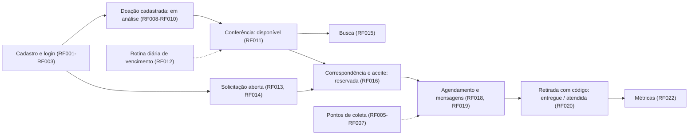

# PRD — ReMed

| Item | Valor |
| --- | --- |
| Produto | ReMed — plataforma web de doação e redistribuição de medicamentos não vencidos |
| Fonte | Documento de Requisitos ReMed (43 páginas, Word, gerado em 21/11/2026) |
| Status | Rascunho para revisão |
| Detalhe dos requisitos | [02-catalogo-requisitos.md](02-catalogo-requisitos.md) (transcrição fiel de RF, RNF, RS e matrizes) |
| Como construir | [arquitetura.md](../arquitetura.md), ADRs em `docs/adr/`, specs em `docs/specs/` |

Este PRD diz **o quê** e **por quê**. Os campos, as regras numeradas e as mensagens de validação de cada requisito estão no catálogo. Os IDs (`RF001`, `RNF01`, `RS001`) são os da fonte.

---

## 1. Resumo executivo

### Problema

Medicamentos não vencidos ficam parados em casa e acabam vencendo sem uso. Ao mesmo tempo, há pessoas que precisam desses mesmos medicamentos e não têm acesso a eles. Não existe um canal seguro que ligue as duas pontas, que confira validade e integridade e que proteja os dados pessoais e de saúde dos envolvidos.

> [!NOTE]
> A seção da fonte que descreveria o sistema (2.1) está vazia, só com o texto-modelo. O problema acima foi tirado das descrições dos requisitos (RF008, RF013, RF016, RF022) e precisa ser confirmado (Questão 1).

### Solução proposta

Uma aplicação web responsiva, aberta ao público, em que doadores cadastram medicamentos e solicitantes ou cuidadores cadastram suas necessidades. O sistema confere a validade, cruza oferta e necessidade por princípio ativo, concentração, forma farmacêutica e proximidade, e organiza a retirada presencial, de preferência em pontos de coleta aprovados. Tudo isso sem expor contato nem endereço das partes.

### Critérios de sucesso

| Indicador | Origem | Meta |
| --- | --- | --- |
| **Quantidade de medicamentos efetivamente entregues (métrica principal)** | RF022, RF020 | TBD |
| Doações cadastradas e solicitações atendidas | RF022 | TBD |
| Taxa de atendimento (solicitações atendidas ÷ solicitações abertas) | RF022 | TBD |
| Tempo médio entre o cadastro da doação e a entrega | RF022 | TBD |
| Medicamentos vencidos antes da entrega | RF022, RF012 | TBD |
| Agendamentos com não comparecimento | RF022, RF018 | TBD |
| Pontos de coleta ativos por região | RF022, RF005, RF007 | TBD |
| Denúncias registradas e procedentes | RF022, RF021 | TBD |

A fonte não define metas numéricas para nenhum indicador (Questão 2).

---

## 2. Experiência do usuário e funcionalidades

### 2.1 Atores

| Ator | O que pode fazer | Origem |
| --- | --- | --- |
| Visitante | Criar conta, consultar a busca resumida, iniciar a recuperação de senha | RF001, RF002, RF003, RF015 |
| Doador | Cadastrar e gerenciar doações, usar a leitura por IA, aceitar correspondências, agendar, trocar mensagens, confirmar entrega | RF008, RF009, RF010, RF016, RF018, RF019, RF020 |
| Solicitante | Cadastrar solicitações, enviar receita, buscar, aceitar correspondências, agendar, trocar mensagens, confirmar retirada | RF013, RF014, RF015, RF016, RF018, RF019, RF020 |
| Cuidador/Familiar | O mesmo que o Solicitante, fazendo o pedido em nome de um terceiro (por exemplo, menor de 18 anos) | RF001, RF013, RF014 |
| Representante da instituição (perfil "Ponto de coleta") | Cadastrar o ponto de coleta, enviar e substituir documentos | RF005, RF006 |
| Administrador | Gerir usuários, aprovar pontos de coleta, conferir doações, verificar receitas, moderar denúncias, ver métricas, ajustar parâmetros das rotinas. Login com dois fatores | RF004, RF007, RF011, RF012, RF014, RF021, RF022 |
| Sistema | Rotina de vencimento, correspondência automática, notificações, leitura por IA | RF009, RF012, RF016, RF017 |

Todo usuário autenticado recebe notificações (RF017) e pode registrar denúncias (RF021). Um mesmo usuário pode ter mais de um perfil entre Doador, Solicitante e Cuidador/Familiar (RF001). O perfil Administrador só pode ser dado por outro Administrador, nunca por si mesmo (RF001, RF004).

### 2.2 Fluxo principal

### 2.3 Histórias de usuário

| ID | História | Origem |
| --- | --- | --- |
| HU01 | Como **Visitante**, quero criar minha conta com CPF e escolher um ou mais perfis para doar, solicitar ou cuidar de alguém. | RF001 |
| HU02 | Como **usuário cadastrado**, quero entrar com e-mail ou CPF e senha, com bloqueio após tentativas inválidas, para que ninguém use minha conta. | RF002, RS005 |
| HU03 | Como **usuário cadastrado**, quero redefinir minha senha por um link enviado ao meu e-mail para voltar a ter acesso. | RF003, RS012 |
| HU04 | Como **Administrador**, quero consultar usuários e mudar o status ou o perfil Administrador deles, com motivo registrado, para manter a plataforma segura. | RF004, RS015 |
| HU05 | Como **Representante da instituição**, quero cadastrar meu estabelecimento como ponto de coleta para que ele vire um local seguro de retirada. | RF005 |
| HU06 | Como **Representante da instituição**, quero enviar e renovar a licença de funcionamento e o alvará sanitário para que o ponto seja aprovado e continue ativo. | RF006 |
| HU07 | Como **Administrador**, quero analisar e aprovar, reprovar, suspender ou inativar pontos de coleta para que só estabelecimentos regulares apareçam. | RF007, RS011 |
| HU08 | Como **Doador**, quero cadastrar um medicamento não vencido, com foto da embalagem, para que ele chegue a quem precisa. | RF008, RS001 |
| HU09 | Como **Doador**, quero que a IA leia a foto da embalagem e sugira os campos para cadastrar mais rápido, conferindo tudo antes de salvar. | RF009, RS009 |
| HU10 | Como **Doador ou Solicitante**, quero orientações e uma janela curta de retirada para medicamentos refrigerados, para que eles não percam a eficácia. | RF010, RS004 |
| HU11 | Como **Administrador (ou responsável pela conferência)**, quero conferir a validade e a integridade de cada doação antes de liberá-la. | RF011, RS001 |
| HU12 | Como **Doador ou Solicitante**, quero que o sistema retire automaticamente os medicamentos vencidos e me avise, para que nada vencido seja entregue. | RF012, RS001 |
| HU13 | Como **Solicitante ou Cuidador/Familiar**, quero cadastrar o medicamento de que preciso, sem informar o motivo de saúde, para ser avisado quando houver doação compatível. | RF013, RS002 |
| HU14 | Como **Solicitante ou Cuidador/Familiar**, quero enviar a receita, que fica protegida, para conseguir medicamentos que exigem receita. | RF014, RS003 |
| HU15 | Como **Visitante ou usuário**, quero buscar medicamentos disponíveis perto de mim sem ver dados do doador. | RF015, RS002, RS010 |
| HU16 | Como **Doador ou Solicitante**, quero receber correspondências automáticas entre oferta e necessidade e aceitá-las, para reservar o medicamento. | RF016, RS007 |
| HU17 | Como **usuário**, quero ser avisado por e-mail e na plataforma dos eventos importantes, sem dados pessoais nas mensagens. | RF017, RS014 |
| HU18 | Como **Doador ou Solicitante**, quero combinar data, horário e local da retirada, de preferência num ponto de coleta, para evitar desencontros. | RF018, RS008 |
| HU19 | Como **parte de uma correspondência**, quero trocar mensagens de texto na plataforma sem revelar meu telefone, e-mail ou endereço. | RF019, RS014 |
| HU20 | Como **Doador ou Solicitante**, quero confirmar a entrega com um código e conferir validade, lote e embalagem, podendo recusar. | RF020, RS001, RS008 |
| HU21 | Como **usuário**, quero denunciar usuários, doações, conversas ou pontos irregulares, e como **Administrador** quero analisar e decidir cada denúncia. | RF021, RS006 |
| HU22 | Como **Administrador**, quero ver os indicadores de entregas em tabela e gráfico e exportá-los, para acompanhar o impacto da plataforma. | RF022 |

### 2.4 Critérios de aceite

Os critérios abaixo resumem as regras principais. A lista completa (campos, mensagens, alteração, exclusão e pesquisa) está no catálogo.

**HU01 — Cadastro de Usuário (RF001)**
- Rejeita CPF com dígito verificador inválido ou já cadastrado ("CPF já cadastrado").
- Rejeita menores de 18 anos.
- Rejeita e-mail já cadastrado ("E-mail já cadastrado") e envia link de confirmação ao e-mail informado.
- Exige senha de no mínimo 8 caracteres, guardada só como hash (RS005).
- Exige o aceite dos Termos de Uso e da Política de Privacidade, registrando versão, data e hora.
- Preenche o endereço pelo CEP. O endereço nunca é exibido a outros usuários (RS002).
- O CPF não pode ser alterado depois do cadastro. Toda alteração fica no histórico (quem, o quê, data e hora).
- O encerramento da conta elimina ou anonimiza os dados pessoais e mantém só os registros anônimos de doações e entregas (RNF10).

**HU02 — Autenticação e Controle de Acesso (RF002)**
- 5 tentativas inválidas em 15 minutos bloqueiam a conta temporariamente ("Muitas tentativas. Tente novamente mais tarde").
- A sessão expira após 30 minutos de inatividade.
- O Administrador só acessa com autenticação em dois fatores.
- Todo acesso, com sucesso ou falha, é registrado com data, hora e usuário.
- Cada perfil só acessa as funções listadas na seção 2.1.

**HU03 — Recuperação de Senha (RF003)**
- A resposta é sempre a mesma, exista ou não o e-mail (RS012).
- O link vale 1 hora, é de uso único e é invalidado por uma nova solicitação. O token é guardado só como hash.
- A nova senha não pode ser igual à atual. Depois da troca, as sessões são encerradas e o usuário é avisado por e-mail.
- Há limite de solicitações por e-mail e por IP (sugerido na fonte: 5 por hora).

**HU04 — Gestão de Usuários pelo Administrador (RF004)**
- O motivo é obrigatório para suspender ou bloquear e é informado ao usuário.
- Usuário suspenso ou bloqueado não entra. Suas doações disponíveis saem da busca e suas reservas e agendamentos são cancelados, com aviso à outra parte.
- O Administrador não muda dados pessoais nem o CPF e vê o CPF parcialmente oculto, nunca receitas ou dados de saúde.
- Ninguém dá o perfil Administrador a si mesmo. Sempre resta ao menos um Administrador ativo ("Não é possível remover o último Administrador ativo").

**HU05 a HU07 — Pontos de coleta (RF005, RF006, RF007)**
- O CNPJ é validado e único. Todo ponto nasce "pendente de aprovação" e só os "ativos" aparecem para doadores e solicitantes.
- O endereço do ponto de coleta é público.
- Licença de funcionamento e alvará sanitário são obrigatórios: PDF, JPG ou PNG de até 5 MB, com validade não anterior à data atual. Só o responsável e o Administrador veem esses documentos.
- Documento vencido sem renovação devolve o ponto para nova análise.
- Aprovar, reprovar ou suspender exige motivo informado ao representante. Suspender cancela ou remarca os agendamentos futuros, com aviso às partes.
- Pontos de coleta e documentos não são excluídos. O histórico não pode ser apagado.

**HU08 — Cadastro de Doação de Medicamento (RF008)**
- Validade e foto da embalagem são obrigatórias. Validade anterior à data atual é rejeitada.
- Embalagem não íntegra bloqueia o cadastro com mensagem explicativa.
- Toda doação nasce "em análise". Alterar validade, lote ou quantidade devolve a doação para "em análise".
- Ao salvar, o sistema mostra que a plataforma não substitui avaliação médica ou farmacêutica (RNF13).
- A residência do doador nunca é sugerida por padrão como local de retirada.
- A doação não é excluída. Ela pode ser cancelada enquanto não for entregue.

**HU09 — Leitura da Embalagem por IA (RF009)** — ver a seção 3.

**HU10 — Gestão de Medicamentos Refrigerados (RF010)**
- O doador declara que o medicamento foi e continuará refrigerado.
- O solicitante confirma ciência da orientação de transporte antes do agendamento.
- A retirada acontece em janela curta, no mesmo dia, de preferência em ponto com refrigeração. O limite de tempo está pendente (Questão 5).
- Refrigerado sem informação de conservação é rejeitado.

**HU11 e HU12 — Conferência (RF011) e Rotina de Vencimento (RF012)**
- A doação só passa a "disponível" depois de aprovada. A reprovação exige motivo informado ao doador.
- A rotina roda uma vez por dia, em horário de menor uso. A validade também é conferida na reserva e no agendamento.
- Doação vencida ou abaixo da validade mínima vira "vencido", sai da busca, tem reservas e agendamentos cancelados, devolve a solicitação para "aberta" e gera aviso com orientação de descarte. Ela nunca volta a "disponível".
- O aviso de doação prestes a vencer vai com antecedência configurável (sugerido na fonte: 15 dias).
- Cada execução é registrada (sucesso, parcial ou falha). Em caso de falha, o Administrador é alertado e a rotina roda de novo.

**HU13 e HU14 — Solicitação (RF013) e Receita (RF014)**
- O motivo de saúde nunca é coletado. Pedido em nome de terceiro exige informar quem fará a retirada.
- Há limite de solicitações abertas por usuário (valor pendente). A solicitação sem correspondência expira (sugerido na fonte: 30 dias), com aviso.
- Medicamento sujeito a receita só entra numa correspondência com a receita "válida". A receita deve ter medicamento, data de emissão, prescritor e assinatura.
- Prescrição de controle especial fica bloqueada (RS003).
- A receita é guardada criptografada, visível só ao verificador, e excluída no prazo da política de privacidade.
- Na retirada, quem retira deve ser a pessoa informada na solicitação.

**HU15 — Busca de Medicamentos e Geolocalização (RF015)**
- Só aparecem doações "disponíveis", ordenadas da mais próxima para a mais distante, 10 por página.
- A localização exige consentimento. O CEP é a alternativa.
- O resultado nunca mostra nome, contato ou endereço do doador. O ponto de retirada só aparece depois do agendamento.
- O Visitante vê só o resultado resumido.
- Sem resultados, aparece "Nenhum medicamento encontrado" e a opção de cadastrar uma solicitação.

**HU16 — Correspondência entre Oferta e Necessidade (RF016)**
- Há correspondência quando coincidem princípio ativo, concentração e forma farmacêutica, dentro do raio da solicitação, respeitando as regras de receita e de refrigerados.
- Com várias solicitações para uma doação, ganha a mais próxima. Em caso de empate, a mais antiga.
- As duas partes têm prazo para aceitar (sugerido na fonte: 48 horas). Vencido o prazo, tudo volta ao estado anterior.
- O aceite reserva a doação para uma única correspondência, em operação transacional (RNF06, RS007).

**HU17 — Notificações (RF017)**
- E-mail e notificação na plataforma são obrigatórios. SMS e aplicativo de mensagens são desejáveis.
- Nenhuma notificação traz dados pessoais, motivo de saúde ou texto de mensagens.
- O envio ocorre em até 5 minutos após o evento, com até 3 novas tentativas em caso de falha, sem bloquear a operação (RNF15).
- As notificações de segurança da conta não podem ser desativadas.

**HU18 — Agendamento da Retirada (RF018)**
- O doador propõe data, horário e local. O solicitante confirma ou sugere outra opção.
- O endereço só é liberado depois da confirmação. Os pontos de coleta são priorizados, respeitando o horário de funcionamento.
- Reagendar ou cancelar é permitido até um prazo antes do horário (sugerido na fonte: 2 horas).
- Sem confirmação de retirada 24 horas após o horário, o agendamento vira "não compareceu" e o medicamento volta a "disponível".

**HU19 — Mensagens dentro da Plataforma (RF019)**
- Só texto, com até 500 caracteres, sem anexos nem links. Telefone, e-mail, endereço, links e pedidos de pagamento são bloqueados ou geram alerta.
- A conversa fica ativa do aceite até a entrega ou o cancelamento. Depois, fica só para leitura.
- Mensagens não podem ser editadas nem apagadas. O Administrador só as vê quando há denúncia.

**HU20 — Confirmação de Retirada e Entrega (RF020)**
- Um código, enviado só ao solicitante, valida a entrega.
- O solicitante confere validade, lote e embalagem com a foto e pode recusar informando o motivo.
- A entrega pode ser parcial. Ao zerar a quantidade, a doação vira "entregue". A solicitação vira "atendida" e o agendamento, "retirado".
- O registro da entrega não pode ser apagado. Correções geram um novo registro.

**HU21 — Denúncia e Moderação (RF021)**
- A denúncia pode ter como objeto um usuário, uma doação, uma solicitação, uma conversa, um ponto de coleta ou uma retirada. A descrição é obrigatória.
- O prazo de análise é configurável (sugerido na fonte: 3 dias úteis). Risco à saúde tem prioridade e retira a doação da busca até a decisão.
- A identidade do denunciante não é revelada. Ele é informado do resultado.
- Há limite de denúncias por usuário. Má-fé reiterada pode suspender o denunciante.

**HU22 — Relatório de Métricas de Entregas (RF022)**
- Mostra tabela e gráfico, filtra por período, região e medicamento ou forma farmacêutica, e exporta em CSV ou PDF.
- Usa só dados agregados e anônimos.

### 2.5 Não-objetivos (nesta versão)

- **Guarda temporária de medicamentos pelo ponto de coleta.** O ponto é só o local do encontro. A guarda depende de definição com o cliente e de validação legal (RF005, RNF11).
- **Logística de entrega.** A retirada é presencial, em local combinado ou instituição, sem entrega obrigatória (RF018).
- **Medicamentos de controle especial.** Ficam bloqueados até a definição do fluxo e a validação jurídica (RF014, RS003).
- **Coleta do motivo de saúde.** O sistema não coleta, não exibe e não compartilha (RF013, RS002).
- **Substituir avaliação médica ou farmacêutica** (RNF13).
- **Decisão automática pela IA.** A IA só sugere (RF009, RS009).
- **Exclusão física** de doações, solicitações, pontos de coleta, documentos, entregas, denúncias e históricos (RF004 a RF008, RF013, RF020, RF021, RNF14).
- **Aplicativo instalável obrigatório.** O produto é web responsivo (RNF07).
- **Anexos e links nas mensagens** (RF019).

---

## 3. Requisitos de IA

Aplica-se ao RF009 (Leitura da Embalagem por IA), de prioridade **Desejável**.

| Aspecto | Requisito | Origem |
| --- | --- | --- |
| Entrada | Foto da embalagem (JPG ou PNG, até 5 MB) anexada no cadastro da doação | RF009, RF008 |
| Saída | Sugestão de nome do medicamento, princípio ativo e concentração, lote, validade e fabricante, com nível de confiança de 0 a 1 por campo | RF009 |
| Modelo | Modelo de IA multimodal em serviço externo | RF009, RNF12 |
| A IA sugere, o usuário confirma | Os dados sugeridos aparecem para o doador conferir e editar antes de salvar, identificados como sugestões | RF009, RS009, RNF13 |
| Baixa confiança | Campos de baixa confiança ficam destacados e exigem confirmação manual. O limite está pendente (Questão 9) | RF009, RS009 |
| Validade | A validade sugerida sempre precisa ser confirmada pelo doador | RF009, RS009 |
| Campos não lidos | Ficam em branco, sem estimativa | RF009, RS009 |
| Falha | Se a IA falhar ou estiver fora do ar, o doador preenche manualmente, sem perder o que já digitou | RF009, RS009 |
| Privacidade | O doador é informado de que a foto vai para um serviço externo e orientado a não fotografar dados pessoais (por exemplo, nome do paciente). As imagens só servem à doação e são eliminadas conforme a política de privacidade | RF009, RS009, RNF10 |
| Desempenho | Resposta em até 15 segundos | RNF04 |
| Integração futura | Avaliar bases ou API de medicamentos para validar nome e concentração | RF009, RNF12 |
| Avaliação da qualidade | TBD: a fonte não define como medir a precisão | — |

---

## 4. Segurança, privacidade e conformidade

### 4.1 Requisitos de segurança

| ID | Perigo | Solução principal | RF afetados |
| --- | --- | --- | --- |
| RS001 | Medicamento vencido, adulterado ou com embalagem violada ser entregue | Validade e foto obrigatórias, validade mínima restante, rotina diária de vencimento, conferência com direito de recusa na retirada | RF008, RF011, RF012, RF020 |
| RS002 | Exposição de dados pessoais ou do motivo de saúde | Não coletar o motivo, mostrar só localização aproximada e identificação reduzida, liberar o local só após o agendamento, criptografar receitas e dados pessoais | RF001, RF013, RF015, RF016, RF017, RF019 |
| RS003 | Medicamento com receita (ou de controle especial) entregue sem receita válida ou a quem não é o beneficiário | Receita verificada antes da correspondência, controle especial bloqueado, conferência da identidade de quem retira, registro de cada verificação | RF014 |
| RS004 | Perda de eficácia de refrigerados | Conservação obrigatória, declaração do doador, ciência do solicitante, janela curta, conferência com direito de recusa | RF010 |
| RS005 | Acesso indevido a contas | Senha com no mínimo 8 caracteres e hash bcrypt ou argon2, bloqueio após 5 tentativas em 15 minutos, expiração de sessão, TLS 1.2 ou superior, dois fatores para Administrador, proteção contra o OWASP Top 10 (CSRF, XSS, injeção de SQL) | RF001, RF002, RF003 |
| RS006 | Uso indevido (excesso de pedidos, revenda, perfis falsos) | CPF único, e-mail confirmado, limites de solicitações, Termos de Uso proibindo comércio, canal de denúncia, suspensão, histórico | RF013, RF016, RF020, RF021 |
| RS007 | Reserva dupla do mesmo medicamento | Reserva transacional, expiração da reserva, atualização da quantidade, notificação das partes | RF008, RF016, RF018 |
| RS008 | Riscos no encontro presencial (golpe, assédio, local inseguro) | Priorizar pontos de coleta, mensagens internas, código de confirmação, denúncia e bloqueio | RF018, RF019, RF020 |
| RS009 | IA ler a embalagem errado | Conferência e edição antes de salvar, destaque de baixa confiança, foto vinculada, cadastro manual sempre possível | RF009 |
| RS010 | Geolocalização revelar localização exata e hábitos | Consentimento explícito, CEP como alternativa, localização aproximada, distância calculada no servidor, sem histórico de trajetos, consentimento revogável | RF015 |
| RS011 | Ponto de coleta falso ou irregular | CNPJ validado, documentos obrigatórios, exibição só após aprovação, revisão periódica, suspensão imediata em caso de denúncia | RF005, RF006, RF007 |
| RS012 | Recuperação de senha usada para descobrir e-mails ou tomar contas | Resposta única, link de 1 hora e uso único guardado como hash, limite por e-mail e IP, encerramento das sessões | RF003 |
| RS013 | Arquivos maliciosos, adulterados ou acessados indevidamente | Validar tipo, extensão e assinatura, limite de 5 MB, antimalware, armazenamento criptografado com nome aleatório fora de diretório público, link temporário e autenticado, registro de envio e acesso | RF006, RF008, RF013, RF014 |
| RS014 | Mensagens e notificações usadas para golpe ou para tirar a conversa da plataforma | Só texto limitado, detecção de contato, links e pagamentos, conversa com prazo, bloqueio e denúncia, notificações sem dados pessoais e só do domínio oficial | RF017, RF019 |
| RS015 | Abuso ou invasão de contas de Administrador | Dois fatores, atribuição só por outro Administrador, permissões separadas por função, registro imutável revisado periodicamente, motivo obrigatório | RF004, RF007, RF021 |

Requisitos não funcionais de segurança: RNF14 (histórico imutável) e RNF16 (tratamento de arquivos).

### 4.2 Conformidade

A fonte cita:

- **LGPD (Lei nº 13.709/2018)** (RNF10). A fonte pede coleta do mínimo necessário, Termos de Uso e Política de Privacidade visíveis, consentimento registrado, receitas tratadas como dados sensíveis e atendimento a pedidos de acesso, correção e eliminação ou anonimização.
- **Legislação sanitária de medicamentos (ANVISA)**, incluindo a **Portaria SVS/MS nº 344/1998** para controle especial (RNF11). A fonte exige validar a viabilidade jurídica da redistribuição entre particulares antes da implantação, e orientar o descarte de vencidos conforme a legislação sanitária (RF012).
- **WCAG 2.1 nível AA** (RNF03).
- **OWASP Top 10** (RS005).

> [!WARNING]
> A viabilidade jurídica da redistribuição entre particulares (RNF11) não foi validada. Este é um bloqueio para a implantação, não para o desenvolvimento (Questão 3).

### 4.3 Dados sensíveis

| Dado | Quem acessa | Nunca |
| --- | --- | --- |
| Receita (dado de saúde) | Só o verificador (RF014) | Doador. Pela RF004, também o Administrador (conflito, Questão 7) |
| Motivo da necessidade de saúde | Ninguém | É coletado, exibido ou compartilhado (RF013, RS002) |
| Endereço do usuário | Só o sistema, para geolocalização aproximada | É exibido a outros usuários (RF001, RS002) |
| Nome, contato e endereço do doador | — | Aparecem na busca, nas notificações ou nas mensagens (RF015, RF017, RF019) |
| Local de retirada | As duas partes, depois do agendamento confirmado | Antes da confirmação (RF015, RF018) |
| CPF | Dono da conta. O Administrador vê parcialmente oculto | Alterado depois do cadastro (RF001, RF004) |
| Documentos do ponto de coleta | Responsável e Administrador | Doadores ou solicitantes (RF006, RS013) |
| Localização | Só a última usada na busca | Histórico de trajetos ou coordenadas exibidas a terceiros (RS010) |
| Mensagens | As duas partes. O Administrador só em caso de denúncia | Editadas, apagadas ou enviadas em notificações (RF019, RS014) |
| Fotos de embalagem | Doador, conferência, retirada e o serviço de IA | Usadas para outra finalidade (RF009) |

### 4.4 Matriz de risco (reproduzida da fonte)

| Probabilidade \ Gravidade | Catastrófico (1) | Crítico (2) | Marginal (3) | Insignificante (4) |
| --- | --- | --- | --- | --- |
| Frequente (A) | | | | |
| Provável (B) | | | RS005, RS009 | |
| Ocasional (C) | RS001 | RS002, RS004, RS012 | RS006, RS014 | |
| Remoto (D) | RS003 | RS008, RS011, RS013, RS015 | RS007, RS010 | |
| Improvável (E) | | | | |
| Eliminado (F) | | | | |

---

## 5. Visão técnica de alto nível

### 5.1 Requisitos não funcionais que condicionam a arquitetura

| ID | Requisito | Prioridade |
| --- | --- | --- |
| RNF04 | Páginas públicas e buscas em até 3 s (percentil 95) com até 500 usuários simultâneos. IA em até 15 s | Importante |
| RNF05 | Disponibilidade mínima de 99% ao mês, backup diário automático com retenção mínima de 30 dias, restauração testada periodicamente | Importante |
| RNF06 | Reserva, agendamento e entrega transacionais, sem reserva dupla. Em falha, desfaz e informa o usuário | Essencial |
| RNF07 | Web responsiva (mobile first) nas duas últimas versões de Chrome, Edge, Firefox e Safari, em computador, Android e iOS, sem instalação obrigatória | Essencial |
| RNF08 | Servidor em nuvem com escalabilidade horizontal, mínimo de 2 vCPU, 4 GB de RAM e 50 GB SSD. Arquivos em armazenamento criptografado, até 5 MB (JPG, PNG, PDF). Usuário com 3G/4G e baixo consumo de dados | Importante |
| RNF09 | Git, API REST, banco relacional, rastreabilidade dos requisitos e documentação atualizada | Desejável |
| RNF14 | Histórico imutável de toda alteração (quem, o quê, data e hora), acessível só ao Administrador | Essencial |
| RNF15 | Rotinas por agendador, com registro e alerta de falha. Notificações em até 5 min, com até 3 novas tentativas | Importante |
| RNF16 | Arquivos com tipo e assinatura verificados, 5 MB, antimalware, nome aleatório, acesso por link temporário e autenticado | Importante |
| RNF01–RNF03 | Linguagem simples, dicas nos botões, ajuda e glossário, mensagens de erro claras, WCAG 2.1 AA | Importante |
| RNF13 | Aviso "não substitui avaliação médica ou farmacêutica" nas telas de doação, solicitação e retirada | Essencial |

### 5.2 Integrações externas (RNF12)

- Consulta de CEP (webservice): RF001, RF005, RF015.
- Mapas e geolocalização: RF015, RF016.
- Envio de e-mail: RF001, RF003, RF017.
- IA multimodal de leitura de imagem, se aprovada a avaliação: RF009.
- Bases ou API de medicamentos, se aprovada a avaliação: RF009.
- Antimalware para arquivos (RNF16, RS013). A fonte não diz se é serviço externo.
- SMS ou aplicativo de mensagens, canais desejáveis: RF017.

### 5.3 Decisões de arquitetura já aceitas

Registradas em `docs/adr/` ([índice completo](../adr/README.md)):

- Django no padrão MVT, com camada de service e templates renderizados no servidor ([ADR 0001](../adr/0001-django-mvt-com-camada-de-service.md)).
- PostgreSQL ([ADR 0002](../adr/0002-postgresql-como-banco-de-dados.md)).
- Python 3.14 ([ADR 0003](../adr/0003-python-3-14.md)).
- pip, `.venv` e `requirements.txt` com versões fixadas ([ADR 0004](../adr/0004-pip-venv-requirements-fixado.md)).
- Bootstrap hospedado no próprio projeto ([ADR 0005](../adr/0005-bootstrap-hospedado-no-projeto.md)).
- JavaScript simples, sem framework de front-end ([ADR 0006](../adr/0006-javascript-simples-sem-framework.md)).

### 5.4 Candidatas a ADR e tensões

| Tema | Tensão ou motivo | Origem |
| --- | --- | --- |
| API REST versus MVT | O RNF09 pede API REST. A ADR 0001 escolheu renderização no servidor. O RNF09 é Desejável | RNF09 |
| Hash de senha | A fonte pede bcrypt ou argon2 | RS005 |
| Dois fatores do Administrador | Mecanismo não definido | RF002, RS015 |
| Permissões administrativas por função | Os RF têm um único perfil Administrador | RS015 |
| Reserva transacional e concorrência | Impedir reserva dupla | RNF06, RS007 |
| Agendador de rotinas | Vencimento, expirações, lembretes, não comparecimento, documentos | RNF15 |
| Armazenamento criptografado e antimalware | Fotos, receitas, documentos | RNF08, RNF16, RS013 |
| Geolocalização e distância no servidor | Localização aproximada, sem guardar trajetos | RF015, RS010 |
| Provedor de IA multimodal | Envio de imagem a terceiro, LGPD, 15 s | RF009, RNF04, RNF10 |
| Notificações (e-mail e plataforma) | Envio assíncrono, novas tentativas, domínio oficial | RF017, RNF15, RS014 |
| Histórico imutável e auditoria | Registro que não pode ser alterado nem apagado | RNF14 |
| Hospedagem | Nuvem com escalabilidade horizontal, 99%, backup | RNF05, RNF08 |

---

## 6. Riscos e entrega em fases

### 6.1 Riscos de produto e projeto

Os riscos de segurança estão na seção 4. Abaixo ficam os riscos de produto e de projeto levantados na análise.

| ID | Risco | Impacto | Mitigação | Origem |
| --- | --- | --- | --- | --- |
| R01 | Redistribuição entre particulares ser considerada ilegal | Impede a implantação | Validação jurídica antes de implantar | RNF11 |
| R02 | Pendências da ata vencidas (critérios de conferência, janela de refrigerados, verificador de receitas) | Bloqueiam RF010, RF011, RF012 e RF014, que são essenciais e estão no MVP | Decidir com o cliente antes das specs desses RF | RF010, RF011, RF014 |
| R03 | Política de privacidade indefinida | Sem prazos de retenção e eliminação. Afeta RF001, RF009, RF014, RF017 e RNF14 | Definir a política antes do MVP | RNF10 |
| R04 | Falta de pontos de coleta ativos numa região | Retirada em local menos seguro | Priorizar pontos e permitir local seguro combinado | RF008, RF018, RS008 |
| R05 | Ninguém para conferir doações e receitas | Doações paradas em "em análise" | Definir o responsável e o prazo de conferência | RF011, RF014 |
| R06 | Não comparecimento frequente | Medicamentos vencem antes da entrega | Lembrete 24 h antes, regra de "não compareceu", métrica | RF017, RF018, RF022 |
| R07 | Leitura errada pela IA | Dados incorretos na doação | A IA só sugere, com conferência humana | RF009, RS009 |

### 6.2 Entrega em fases

Regra adotada: Essencial = MVP, Importante = v1.1, Desejável = v2.0. Os requisitos **importantes de que o MVP depende foram antecipados para o MVP**, marcados com ⬆.

| Fase | Requisitos | Observação |
| --- | --- | --- |
| **MVP** | RF001, RF002, RF008, RF010, RF011, RF012, RF013, RF014, RF015, RF016, RF017, RF018, RF020 (essenciais) | Fluxo de ponta a ponta: doar, conferir, buscar, corresponder, agendar e entregar |
| **MVP ⬆** | RF004 ⬆, RF005 ⬆, RF006 ⬆, RF007 ⬆, RF019 ⬆ (importantes antecipados) | RF004: criar e gerir Administradores, que fazem a conferência (RF011, RF014). RF005 a RF007: pontos de coleta usados em RF008, RF010 e RF018. RF019: o RF018 combina os detalhes por mensagens |
| **MVP (não funcionais)** | RNF06, RNF07, RNF10, RNF11, RNF13, RNF14 (essenciais) | RNF11 é condição para implantar |
| **v1.1** | RF003, RF021, RF022. RNF01 a RNF05, RNF08, RNF12, RNF15, RNF16 | Ver Questões 16 e 17 sobre RF021 e RNF15/RNF16 |
| **v2.0** | RF009, RNF09 | IA da embalagem. API REST conforme ADR |

> [!IMPORTANT]
> Alguns requisitos do MVP citam requisitos da v1.1: RF020 (denúncia na retirada) e RS006 e RS008 citam o RF021; o RF012 depende das rotinas do RNF15; arquivos do MVP (RF006, RF008, RF014) dependem das regras do RNF16. Isso está nas Questões 16 e 17.

---

## 7. Rastreabilidade

### 7.1 Requisito, prioridade, fase e história

| RF | Nome | Prioridade | Fase | História | Spec |
| --- | --- | --- | --- | --- | --- |
| RF001 | Cadastro de Usuário | Essencial | MVP | HU01 | [01-cadastro-de-usuario.md](../specs/01-cadastro-de-usuario.md) |
| RF002 | Autenticação e Controle de Acesso | Essencial | MVP | HU02 | [02-autenticacao-e-controle-de-acesso.md](../specs/02-autenticacao-e-controle-de-acesso.md) |
| RF003 | Recuperação de Senha | Importante | v1.1 | HU03 | [20-recuperacao-de-senha.md](../specs/20-recuperacao-de-senha.md) |
| RF004 | Gestão de Usuários pelo Administrador | Importante | MVP ⬆ | HU04 | [04-gestao-de-usuarios-administrador.md](../specs/04-gestao-de-usuarios-administrador.md) |
| RF005 | Cadastro de Ponto de Coleta (Pessoa Jurídica) | Importante | MVP ⬆ | HU05 | [05-cadastro-de-ponto-de-coleta.md](../specs/05-cadastro-de-ponto-de-coleta.md) |
| RF006 | Envio de Documentos do Ponto de Coleta | Importante | MVP ⬆ | HU06 | [06-envio-documentos-ponto-de-coleta.md](../specs/06-envio-documentos-ponto-de-coleta.md) |
| RF007 | Aprovação do Ponto de Coleta | Importante | MVP ⬆ | HU07 | [07-aprovacao-ponto-de-coleta.md](../specs/07-aprovacao-ponto-de-coleta.md) |
| RF008 | Cadastro de Doação de Medicamento | Essencial | MVP | HU08 | [08-cadastro-de-doacao.md](../specs/08-cadastro-de-doacao.md) |
| RF009 | Leitura da Embalagem por IA | Desejável | v2.0 | HU09 | [23-leitura-embalagem-por-ia.md](../specs/23-leitura-embalagem-por-ia.md) |
| RF010 | Gestão de Medicamentos Refrigerados | Essencial | MVP | HU10 | [09-medicamentos-refrigerados.md](../specs/09-medicamentos-refrigerados.md) |
| RF011 | Conferência e Aprovação de Validade | Essencial | MVP | HU11 | [10-conferencia-e-aprovacao-de-validade.md](../specs/10-conferencia-e-aprovacao-de-validade.md) |
| RF012 | Rotina Automática de Vencimento | Essencial | MVP | HU12 | [11-rotina-automatica-de-vencimento.md](../specs/11-rotina-automatica-de-vencimento.md) |
| RF013 | Cadastro de Solicitação de Medicamento | Essencial | MVP | HU13 | [12-cadastro-de-solicitacao.md](../specs/12-cadastro-de-solicitacao.md) |
| RF014 | Fluxo para Medicamentos Sujeitos a Receita | Essencial | MVP | HU14 | [13-fluxo-medicamentos-sujeitos-a-receita.md](../specs/13-fluxo-medicamentos-sujeitos-a-receita.md) |
| RF015 | Busca de Medicamentos e Geolocalização | Essencial | MVP | HU15 | [14-busca-e-geolocalizacao.md](../specs/14-busca-e-geolocalizacao.md) |
| RF016 | Correspondência entre Oferta e Necessidade | Essencial | MVP | HU16 | [15-correspondencia-oferta-e-necessidade.md](../specs/15-correspondencia-oferta-e-necessidade.md) |
| RF017 | Notificações | Essencial | MVP | HU17 | [03-notificacoes.md](../specs/03-notificacoes.md) |
| RF018 | Agendamento da Retirada | Essencial | MVP | HU18 | [16-agendamento-da-retirada.md](../specs/16-agendamento-da-retirada.md) |
| RF019 | Mensagens dentro da Plataforma | Importante | MVP ⬆ | HU19 | [17-mensagens-na-plataforma.md](../specs/17-mensagens-na-plataforma.md) |
| RF020 | Confirmação de Retirada e Entrega | Essencial | MVP | HU20 | [18-confirmacao-de-retirada-e-entrega.md](../specs/18-confirmacao-de-retirada-e-entrega.md) |
| RF021 | Denúncia e Moderação | Importante | v1.1 | HU21 | [21-denuncia-e-moderacao.md](../specs/21-denuncia-e-moderacao.md) |
| RF022 | Relatório de Métricas de Entregas | Importante | v1.1 | HU22 | [22-relatorio-de-metricas-de-entregas.md](../specs/22-relatorio-de-metricas-de-entregas.md) |
| *(NOVO)* | Consulta Somente Leitura de Auditoria *(transversal — RNF14, RS013, RS015, ADR 0011)* | Essencial (RNF14) | MVP | — | [19-consulta-de-auditoria.md](../specs/19-consulta-de-auditoria.md) |

### 7.2 Matriz de dependências (reproduzida da fonte)

D = o requisito da linha depende do requisito da coluna. R = existe algum relacionamento.

| Requisito | Depende de (D) | Relaciona-se com (R) |
| --- | --- | --- |
| RF001 | — | — |
| RF002 | RF001 | RF003, RF022 |
| RF003 | RF001 | RF002, RF017 |
| RF004 | RF001, RF002 | RF017, RF021 |
| RF005 | RF001, RF002 | RF008, RF010, RF018 |
| RF006 | RF002, RF005 | RF007, RF017 |
| RF007 | RF002, RF005 | RF006, RF017, RF018, RF021, RF022 |
| RF008 | RF002 | RF005, RF013, RF014, RF021 |
| RF009 | RF008 | RF011 |
| RF010 | RF008 | RF005, RF014, RF018, RF020 |
| RF011 | RF008 | RF009, RF014, RF017, RF022 |
| RF012 | RF008, RF011 | RF015, RF016, RF017, RF018, RF022 |
| RF013 | RF002 | RF008, RF015, RF017 |
| RF014 | RF013 | RF008, RF010, RF011, RF016 |
| RF015 | RF008, RF011 | RF012, RF013, RF016 |
| RF016 | RF008, RF011, RF013 | RF012, RF014, RF015, RF017 |
| RF017 | RF001 | RF003, RF004, RF006, RF007, RF011, RF012, RF013, RF016, RF018, RF019, RF021 |
| RF018 | RF016 | RF005, RF007, RF010, RF012, RF017, RF019, RF021, RF022 |
| RF019 | RF016 | RF017, RF018, RF020, RF021 |
| RF020 | RF018 | RF010, RF019, RF021 |
| RF021 | RF002 | RF004, RF007, RF008, RF017, RF018, RF019, RF020, RF022 |
| RF022 | RF020 | RF002, RF007, RF011, RF012, RF018, RF021 |

---

## 8. Questões em aberto

| # | Questão | Origem | Quem decide |
| --- | --- | --- | --- |
| 1 | A seção 2.1 (descrição do sistema) está vazia, com texto-modelo. Confirmar o problema e a solução descritos neste PRD | Seção 2.1 | Cliente / PO |
| 2 | Metas numéricas dos indicadores não definidas | RF022 | Cliente / PO |
| 3 | Viabilidade jurídica da redistribuição entre particulares precisa ser validada antes da implantação | RNF11 | Cliente / Jurídico |
| 4 | **Prazo vencido (03/11/2026):** critérios de conferência e de comprovação da validade (validade mínima restante, uso da foto, conferência manual ou automática) | RF011, RF012, RS001 | Cliente |
| 5 | **Prazo vencido (10/11/2026):** limite de tempo da janela de retirada de refrigerados | RF010 | Cliente |
| 6 | **Prazo vencido (10/11/2026):** quem verifica as receitas | RF014 | Cliente |
| 7 | Conflito: o RF004 diz que o Administrador nunca vê receitas. O RF014 lista o "Administrador (verificador)" e o RS015 cita o acesso do Administrador a receitas | RF004, RF014, RS015 | Cliente / PO |
| 8 | Política de privacidade e consentimento (prazos de retenção, eliminação de imagens, receitas, notificações e históricos, prazo de encerramento de conta) "em pendência da ata", sem prazo | RNF10, RF001, RF009, RF014, RF017, RNF14 | Cliente / Jurídico |
| 9 | Limite de confiança da IA para destacar campos ("fase de detalhamento") | RF009 | Equipe / PO |
| 10 | Critérios de aprovação de pontos de coleta ("detalhamento do cadastro") | RF007 | Cliente |
| 11 | Limite de solicitações abertas por usuário e de quantidade por período (RS006). Limite de denúncias por usuário (RF021). Limite de envio de notificações por usuário (RS014) | RF013, RF021, RS006, RS014 | Cliente / PO |
| 12 | Prazo de expiração da reserva quando o agendamento não é confirmado (RS007), sem valor no RF016 nem no RF018 | RS007 | Cliente / PO |
| 13 | Valores "sugeridos" na fonte a confirmar: 5 pedidos de recuperação por hora (RF003), aviso de vencimento com 15 dias (RF012), expiração da solicitação em 30 dias (RF013), aceite em 48 h (RF016), reagendar ou cancelar até 2 h antes (RF018), análise de denúncia em 3 dias úteis (RF021) | Vários | Cliente / PO |
| 14 | Inconsistência: a tela de login aceita "E-mail, CPF ou CNPJ", enquanto o RF002 define "E-mail ou CPF" e a tela de ponto de coleta diz que a instituição não tem senha própria. **Decisão provisória ([ADR 0007](../adr/0007-modelo-de-usuario-customizado.md)):** a implementação seguirá `"E-mail ou CPF"` (alinhada ao RF002 e ao RF005), corrigindo a divergência da tela de origem — **pendente de confirmação com o professor** | RF002, RF005, telas, ADR 0007 | Professor / PO |
| 15 | Inconsistência de perfis: o RF001 só oferece Doador, Solicitante e Cuidador/Familiar. O RF002 cita o perfil "Ponto de coleta (representante da instituição)" sem dizer como ele é atribuído, e não o inclui na lista de usuários do RF002 | RF001, RF002, RF005 | PO |
| 16 | O RF021 (v1.1) é citado por requisitos do MVP: denúncia na retirada (RF020), RS006 e RS008, e suspensão de ponto por denúncia (RF007). Antecipar o RF021? | RF020, RF007, RS006, RS008 | PO |
| 17 | RNF15 (agendador) e RNF16 (arquivos), ambos Importantes, condicionam o RF012 e os envios de arquivo do MVP. O RNF15 lista só 3 rotinas, mas os RF também pedem: "não compareceu" após 24 h (RF018), lembrete 24 h antes (RF017), aviso e vencimento de documentos (RF006), expiração da reserva (RS007) e revisão periódica de pontos (RF007) | RNF15, RNF16 | Equipe / PO |
| 18 | O RNF09 (API REST) conflita com a ADR 0001 (MVT com renderização no servidor). A API está como candidata a ADR para a v2.0 | RNF09, ADR 0001 | Equipe |
| 19 | O RS015 pede permissões administrativas separadas por função. Os RF têm um único perfil Administrador, e o RF011 cita um "responsável pela conferência" sem definição | RS015, RF011 | PO |
| 20 | Como criar o primeiro Administrador, já que o perfil só pode ser dado por outro Administrador | RF001, RF004 | Equipe |
| 21 | Na recusa da retirada, quem decide se a doação volta a "disponível" ou vai para "reprovado" | RF020 | PO |
| 22 | Depois de "não compareceu", o RF018 devolve a doação a "disponível", mas não diz o novo status da solicitação nem da correspondência | RF018 | PO |
| 23 | A seção 1.2.2 diz que as prioridades estão nas seções 4 e 5, mas os RS (seção 5) não têm prioridade e os RF (seção 3) têm. A numeração da lista começa em 9 | Seção 1.2.2 | Autor do documento |
| 24 | A contagem de pontos de função para no total não ajustado (485 PF). Faltam o fator de ajuste e o total ajustado | Seção 8 da fonte | Autor do documento |
| 25 | No RF015, o filtro "Validade mínima restante" tem tipo Date, mas o mesmo conceito no RF012 é em dias (Integer) | RF015, RF012 | PO |
| 26 | O endereço do ponto de coleta é público (RF005), mas o ponto de retirada de uma doação só é revelado após o agendamento (RF015). Confirmar que a busca não indica o ponto escolhido pelo doador | RF005, RF015 | PO |
| 27 | **Funcionalidades citadas sem requisito próprio** (não foram criados requisitos para elas): avaliação de usuário (RF020); bloqueio de outro usuário (RF019, RS008, RS014); manutenção dos cadastros de apoio (formas farmacêuticas, tipos de estabelecimento e de documento, motivos); gestão das versões de Termos de Uso e Política de Privacidade (RF001); pedidos LGPD de acesso e correção (RNF10); revogação do consentimento de localização (RS010); revisão periódica de pontos e dos registros administrativos (RF007, RS015); preferências de notificação, já que só as de segurança "não podem ser desativadas" (RF017); glossário e ajuda (RNF01); confirmação de e-mail (RF001); link "Não sei meu CEP" (tela de cadastro); bloqueio de controle especial com identificação do medicamento (RS003) | Vários | PO |

---

## 9. Glossário

| Termo | Definição |
| --- | --- |
| Doação | Medicamento não vencido oferecido por um Doador. Status: em análise, disponível, reservado, entregue, vencido, reprovado, cancelado (RF008) |
| Solicitação | Necessidade de um medicamento cadastrada por Solicitante ou Cuidador/Familiar. Status: aberta, correspondida, agendada, atendida, cancelada, expirada (RF013) |
| Correspondência | Cruzamento automático entre uma doação disponível e uma solicitação aberta, que exige o aceite das duas partes. Status: pendente de aceite, aceita, recusada, expirada (RF016) |
| Reserva | Estado "reservado" da doação depois do aceite da correspondência, exclusivo para uma correspondência por vez (RF016, RS007) |
| Agendamento | Data, horário e local combinados para a retirada. Status: proposto, confirmado, reagendado, cancelado, retirado, não compareceu (RF018) |
| Retirada / Entrega | Ato presencial em que o solicitante recebe o medicamento, validado por código de confirmação (RF020) |
| Ponto de coleta | Pessoa jurídica (farmácia, posto ou unidade de saúde, hospital, clínica, ONG ou instituição social, outros) aprovada como local seguro de encontro. Não guarda medicamentos nesta versão. Status: pendente de aprovação, ativo, suspenso, inativo (RF005) |
| Representante da instituição | Usuário (pessoa física) vinculado a um ponto de coleta como responsável (RF005) |
| Cuidador/Familiar | Perfil que solicita em nome de um terceiro, inclusive menores de 18 anos (RF001, RF013) |
| Conferência | Análise da validade e da integridade da doação antes de liberá-la (RF011) |
| Validade mínima restante | Número de dias de validade que a doação precisa ter para ficar disponível. Valor pendente (RF011, RF012) |
| Princípio ativo | Substância responsável pelo efeito do medicamento. Usado na correspondência (RF016) |
| Concentração/dosagem | Quantidade do princípio ativo (ex.: 500 mg) |
| Forma farmacêutica | Apresentação do medicamento: comprimido, cápsula, xarope, injetável, pomada, colírio etc. (RF008) |
| Medicamento refrigerado | Exige conservação refrigerada, em geral entre 2 °C e 8 °C, prevalecendo a bula (RF010) |
| Sujeito a receita | Medicamento que exige receita válida antes da correspondência (RF014) |
| Controle especial | Medicamentos da Portaria SVS/MS nº 344/1998. Bloqueados nesta versão (RF014, RS003, RNF11) |
| Receita | Prescrição anexada pelo solicitante, tratada como dado sensível. Status da verificação: pendente, válida, inválida (RF014) |
| Verificador | Responsável por verificar receitas. Pendente de definição (RF014) |
| Denúncia | Registro de uso indevido para moderação. Status: aberta, em análise, procedente, improcedente (RF021) |
| Histórico | Registro imutável de quem fez o quê, com data e hora (RNF14) |
| Não comparecimento | Agendamento sem confirmação de retirada 24 h após o horário (RF018) |
